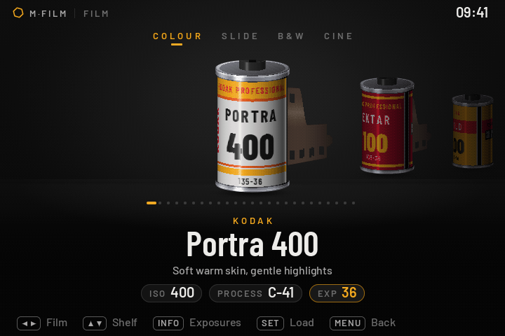

# M-Film for the Canon EOS 6D Mark II

**A port of [M-Film](https://github.com/HNGSeries/mfilm-canon-film-simulation) to the Canon EOS 6D Mark II (firmware 1.1.1).**

M-Film turns the camera into a film camera. Load a roll from a shelf of films, shoot it, then develop it
in the camera's darkroom. The original M-Film by HNGSeries runs on Canon's DIGIC 4 and 5 cameras. This fork
makes it run on the 6D Mark II, a DIGIC 7 body that the original doesn't support, and makes it faster there.

[](../../releases/latest)
[](LICENSE)



> [!WARNING]
> **For one camera only: the Canon EOS 6D Mark II with firmware 1.1.1.** Don't put it on any other camera.
> Magic Lantern on the 6D Mark II is experimental, and this build has been tried on one camera.
> You use it at your own risk.

## Install

The zip has everything, Magic Lantern included: you don't install Magic Lantern separately.

1. Check the camera's firmware: MENU → the last settings tab → *Firmware ver.* It must say 1.1.1.
2. Copy your photos off the card, then format the card in the camera.
3. Unzip `M-Film-camera-6D2.111.zip` onto the card's root. The top of the card must show
   `autoexec.bin`, `ML-SETUP.FIR` and the `ML` folder.
4. MENU → *Firmware ver.* → update. Follow the screen, then switch the camera off and on.
   You do this once per camera.
5. Press **Trash** to open M-Film. This works with or without LiveView.

To update, format the card in the camera and copy the new zip's files to it. Step 4 isn't needed again.
To remove M-Film, format the card: a card without Magic Lantern starts the camera as usual.

If the camera doesn't start, take the battery out and remove the card. Without the card it starts as usual.
`M-FILM-README.txt` in the zip has the details.

## What this fork adds

| | |
|---|---|
| **Runs on the 6D Mark II** | Magic Lantern changes for the 6D Mark II's DIGIC 7 and screen. The film OS is built as a module (`filmos.mo`) for its Cortex-A9 processor. |
| **Faster developing** | One frame takes about 10 s in Small, 21–25 s in Medium and 36–39 s in Large. Before, Small took 26–29 s and Large 75–79 s. RAW reading went from 11.5 s to 1.6 s. LiveView pauses while a roll develops. |
| **Less memory at power on** | 380 KB instead of 549 KB, because the film OS loads as a module after start-up. |
| **Print sizes and date stamp** | Small, Medium and Large prints, zoom in Prints, and a date stamp. These are ported from M-Film 0.2. |
| **Without LiveView** | M-Film opens with the viewfinder too, not only in LiveView. |
| **One button scheme** | MENU goes back, PLAY opens Prints and Trash returns to the camera. INFO is the screen's second action and SET selects. This is the same on every screen. |
| **Fixes** | Dates in the roll list. No leftovers on screen after Prints. Trash works again in Canon's format screen, for low-level format. The shelf is cleaner on the 6D Mark II's screen. |

The technical notes are in [ml-dev/fork/ml-patches/6D2.111](ml-dev/fork/ml-patches/6D2.111/README.md).

## Buttons

| Button | What it does, on every screen |
|---|---|
| Trash | opens M-Film; inside it, back to the camera (in the Darkroom list it deletes the marked rolls) |
| MENU | back |
| PLAY | Prints |
| INFO | the screen's second action, shown at the bottom |
| SET | select, confirm |
| Half-press, LV | back to shooting |

## Build it yourself

```
docker build -t mfilm-build ml-dev/fork/ml-patches/6D2.111
docker run --rm -v "$PWD:/w" -w /w mfilm-build bash ml-dev/build_fork.sh 6D2.111
```

The card files end up in `ml-dev/out/fork-6D2.111/`.

## Problems

Report them in this fork's [Issues](../../issues), not to the original M-Film. Attach `ML/FILMROLL.LOG` from the card.

## Credits and license

- **M-Film** is by **HNGSeries**: the film OS, the 72 films and the darkroom. The original, for the other cameras, is at
  [HNGSeries/mfilm-canon-film-simulation](https://github.com/HNGSeries/mfilm-canon-film-simulation).
- It is built on [Magic Lantern](https://www.magiclantern.fm/) and its
  [magiclantern_simplified](https://github.com/reticulatedpines/magiclantern_simplified) port for newer cameras.
- The film colours come from [Film-Luts](https://github.com/YahiaAngelo/Film-Luts); the fonts and other parts are listed
  in [THIRD_PARTY.md](THIRD_PARTY.md).
- License: GPL-2.0 ([LICENSE](LICENSE)).
- Not affiliated with Canon, Kodak, Fujifilm or any film maker.
